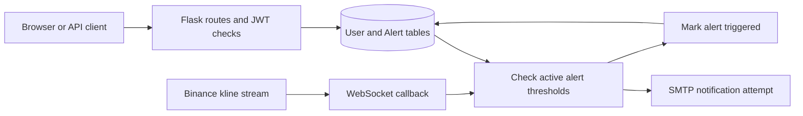

# Cryptocurrency Price Alerts

**A Flask API prototype for creating price thresholds and connecting market events to email notifications.**

The project combines JWT-protected alert endpoints, SQLAlchemy models, a Binance WebSocket client, and SMTP notification code. It was submitted as the **tanX backend price-alert assignment** by **Kelavath Balaji Naik (21BCE9738), VIT-AP, Amaravati**.

[API](#api-reference) · [Setup status](#setup-status) · [Architecture](#architecture) · [Source guide](#source-guide)

## Why this project

A price alert is a useful backend design exercise: an authenticated request creates durable state, a stream provides changing prices, and a matching event produces a notification. This repository explores that flow and the distinction between an alert that is created, deleted, or triggered.

## Implemented pieces

- Signup and login handlers that return a JWT for authenticated API requests.
- Alert creation, soft deletion, permanent deletion, and status-based retrieval.
- Paginated alert listing with count and page response headers.
- User and Alert database models, HTML templates, and static assets.
- Binance one-minute kline subscription code and SMTP email handlers.

The notification pipeline requires repairs described below; this README does not imply the default container produces working live alerts.

## API reference

| Method | Path | Behavior |
| --- | --- | --- |
| POST | `/signup` | Accept `username`, `password`, and `email` |
| POST | `/login` | Return an `access_token` for valid credentials |
| POST | `/alerts/create` | Accept `coin` and `target_price` |
| DELETE | `/alerts/delete/<alert_id>` | Mark the authenticated user's alert as deleted |
| DELETE | `/alerts/delete/real/<alert_id>` | Permanently remove the user's alert |
| GET | `/alerts` | Paginated alerts, defaulting to `created` status |
| GET | `/alerts/<status>` | Alerts matching `created`, `deleted`, or `triggered` |

Alert endpoints require `Authorization: Bearer <access_token>`. `/alerts` accepts `page`, `per_page`, and `status`; defaults are page `1` and `10` items. An empty result returns `404`. Pagination headers are `X-Total-Count`, `X-Total-Pages`, `X-Current-Page`, and `X-Per-Page`.

The root route and GET `/signup` and `/login` render the included HTML pages.

## Example API workflow

After configuring a working local instance, create an account with fictional development data:

```bash
curl http://localhost:5000/signup \
  -H 'Content-Type: application/json' \
  -d '{"username":"demo_user","password":"local-example-only","email":"demo@example.com"}'
```

Log in through `POST /login`, then use the returned token for a request with this alert body:

```json
{
  "coin": "BTC",
  "target_price": 50000.0
}
```

The handler allows one alert per user and coin. Recreating a deleted alert restores its status but currently keeps the previous target price. A new alert subscribes to the coin's USDT one-minute kline stream when the WebSocket reference is available. The matching condition is **current price greater than or equal to target**, not an exact-equality condition or a downward-crossing alert.

## Setup status

The repository includes a Python 3.9 Dockerfile and a Compose definition for MySQL plus Flask. Download and extract the repository before reviewing these configuration and implementation issues:

1. `app.py` imports `flask_bcrypt`, but `requirements.txt` does not declare Flask-Bcrypt. Add a compatible dependency before building the image.
2. Docker runs `python -u app.py`. Its `app.run(debug=True)` call binds to localhost; the Compose `FLASK_RUN_HOST` variable does not change that direct call. Adjust the application binding for container access.
3. `run_websocket()` creates a local socket but does not assign it to the global `WEB_SOCKET` used by subscription helpers. Repair that connection before expecting active subscriptions or triggered alerts.
4. Configure your own database, application secret, and SMTP credentials. The current source contains embedded configuration values; they must not be reused or treated as deployment defaults.
5. Review database initialization and the included `dump.sql` against the current models. The main `app.py` entry point does not create tables automatically.

After addressing those prerequisites, the provided container workflow is:

```bash
docker compose up --build
```

Compose maps Flask to port `5000` and MySQL to host port `3500`. It passes `DATABASE_URL` to the application and declares `MYSQL_DATABASE`, `MYSQL_USER`, `MYSQL_PASSWORD`, and `MYSQL_ROOT_PASSWORD` for the database. The SMTP and application-secret settings currently require source configuration; they are not implemented as environment-variable options.

## Architecture



The diagram describes the components and intended event flow; subscription wiring in the default entry point needs the repair noted above. A separate `websocket_client.py` contains another implementation and is not the Docker entry point.

## Source guide

| Path | Responsibility |
| --- | --- |
| [app.py](app.py) | Container entry point, routes, models, and event handlers |
| [websocket_client.py](websocket_client.py) | Alternative combined API/WebSocket implementation |
| [docker-compose.yaml](docker-compose.yaml) | Flask and MySQL services |
| [requirements.txt](requirements.txt) | Pinned Python dependencies |
| [dump.sql](dump.sql) | Included database initialization file |
| [templates](templates) and [static](static) | Browser pages and assets |

## Prototype boundaries

Passwords are currently stored and compared as plain text even though Bcrypt is initialized. Subscription state is process-local, and SMTP handling does not establish reliable or exactly-once notification delivery. These are material limitations for a real account service. The original assignment reported manual Postman checks; no current automated verification or working deployment is claimed here.
